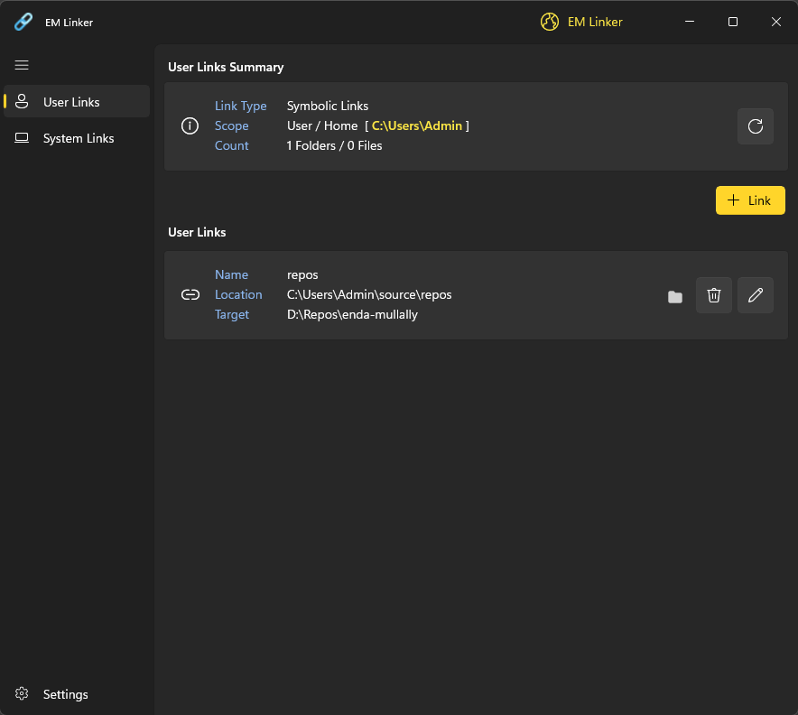
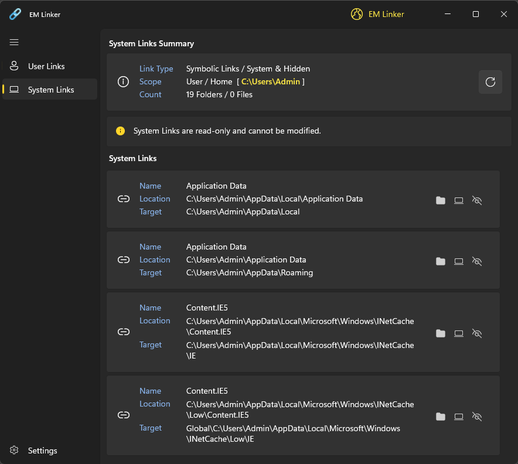
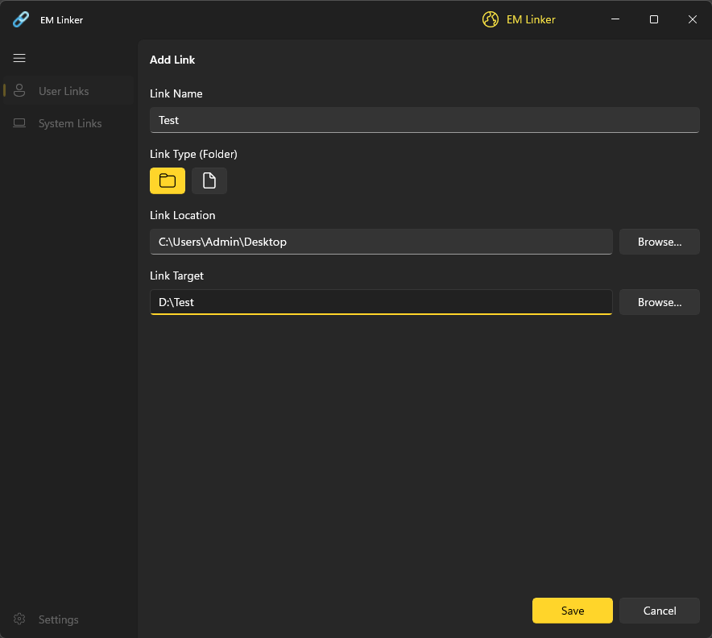
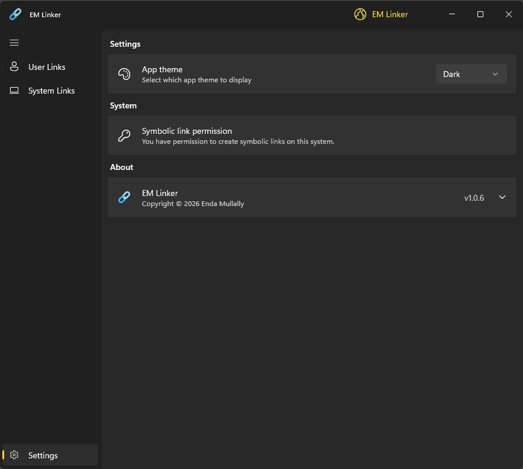
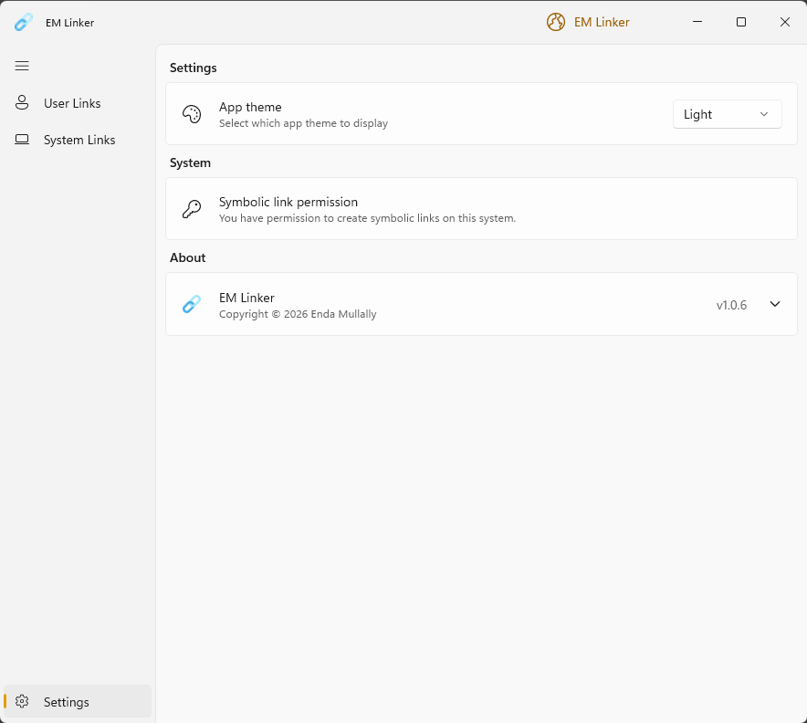

  

<h1 align="center">
  EM Linker
</h1>

  Windows 11 Symbolic Link Manager

  

## Overview

EM Linker is a symbolic link or soft link Manager for Windows 11. It helps you manage User links in your Home folder (`%USERPROFILE%` or `$HOME`), inspect System Links and keep track of links you create elsewhere (Global Links). Built from the ground up for Windows 11.

- **User Links** lets you manage symbolic links located in your Home folder.
- **System Links** shows special (system & hidden) links located in your Home folder. These links are read-only and shown for informational purposes only.
- **Global Links** tracks links created with EM Linker anywhere on your system (for example, at `C:\`, `C:\Program files` or evan a Folder on another Drive). Creating links in protected locations may require administrator permission.

## Screenshots

  

  

  

  

  

 
